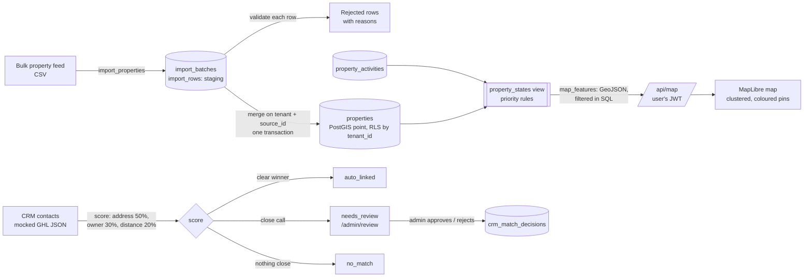
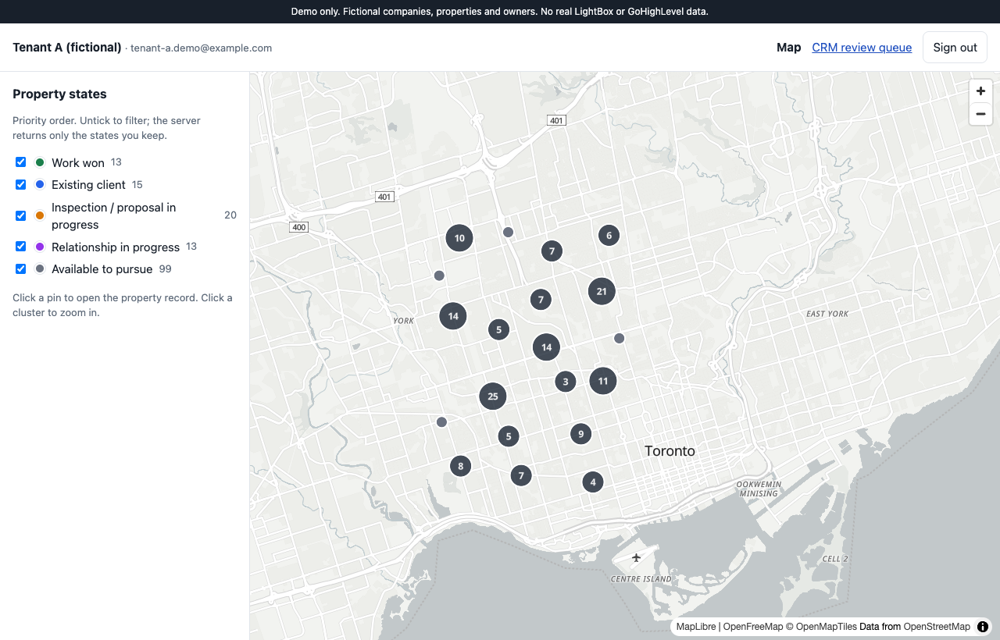
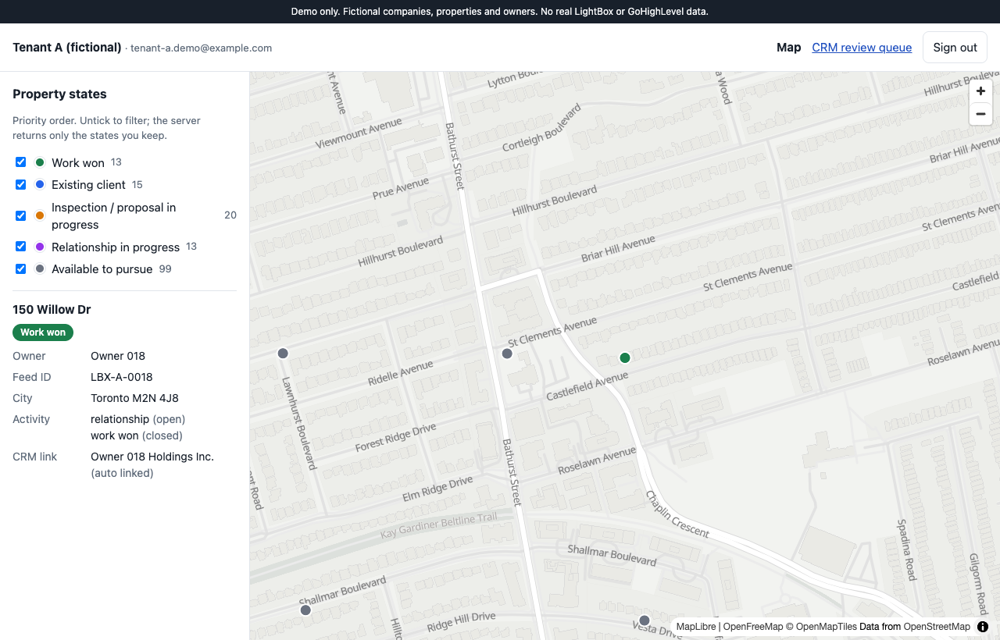
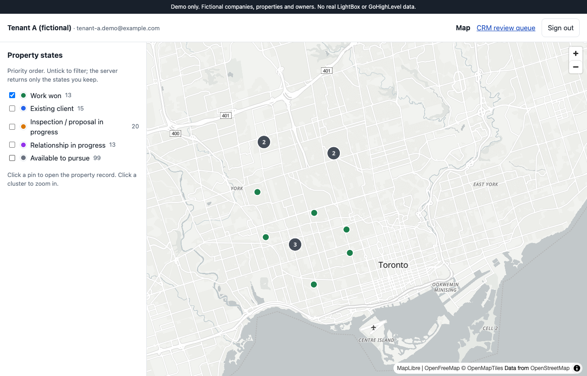
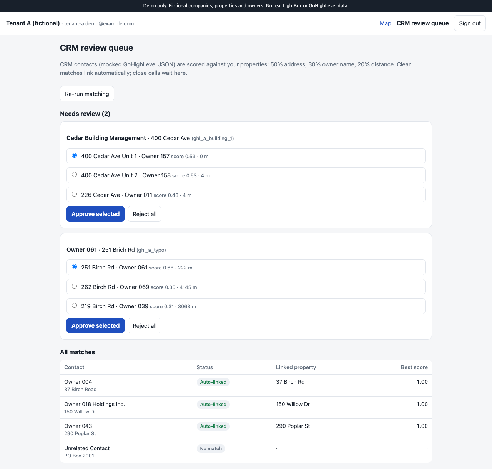

# Multi-tenant property map (demo)

[](https://github.com/getupworkdev/multi-tenant-property-map-demo/actions/workflows/ci.yml)

> **DEMO ONLY.** Two fictional client companies ("Tenant A", "Tenant B"), 300 made-up properties around Toronto with
> "Owner 001"-style names, and a mocked GoHighLevel-style contact export. No real LightBox, GoHighLevel, owner or address data.

**Live:** https://multi-tenant-property-map-demo.vercel.app (click "Sign in as Tenant A" or "Sign in as Tenant B")

A Next.js + Supabase/PostGIS app where several client companies share one database and each sees only its own
properties on a map. Tenant separation is enforced by Postgres row-level security on every table, so it holds whatever
the app code does. The app uses only the publishable key and the signed-in user's session; there is no service-role key
anywhere in it. Every property gets exactly one state from a single SQL view with a fixed priority, and the map colours,
legend and filters all read from that view. Property feeds come in through a CSV → staging → validation → merge
pipeline that runs in one transaction. CRM contacts are matched to properties by normalised address, owner name and
distance. Clear matches link automatically and close calls wait in an admin review queue.

Stack: Next.js 16 (App Router) · TypeScript · Supabase (Postgres, PostGIS, pg_trgm, RLS, Auth) · MapLibre GL with
free OpenStreetMap tiles · Vitest with an in-process Postgres + PostGIS (PGlite) · Vercel · GitHub Actions.

## How data flows



## What the tests prove

`npm test` runs 37 tests against a real Postgres (PGlite) with PostGIS and pg_trgm. It applies the same migration as
production, plus a small shim that recreates Supabase's `anon`/`authenticated` roles and `auth.uid()`. Every query in
the tests runs as a specific signed-in user with RLS active, the same way PostgREST runs it.

| Test file | Guarantee |
| --- | --- |
| `1-tenant-isolation` (13) | Signed in as Tenant A, every tenant table returns zero Tenant B rows. Tenant B's rows do exist, so the zeros come from RLS and not from empty tables. The map data endpoint returns only the caller's features. A Tenant A admin cannot decide a Tenant B match. Nobody can write to the tables directly, and anonymous callers read nothing. A scan of the source and env names finds no service-role key. |
| `2-state-priority` (11) | Each combination of activities resolves to exactly one state, by priority: **work won > existing client > inspection/proposal in progress > relationship in progress > available**. Closed proposals and closed relationships don't count. The legend table lists the five states in that order. Map features carry the view's state, and a state filter returns exactly those states. |
| `3-import` (6) | The CSV parser handles quoted fields, escaped quotes and CRLF. Good rows are merged, and each bad row is rejected with a reason: missing or duplicate source ID, missing address or owner, bad or out-of-range coordinates. Re-importing the same file creates no duplicates and changes nothing. A changed row is updated in place by its source ID. A failure part-way rolls back the whole batch. Imports land only in the caller's tenant, and only admins can import. |
| `4-crm-matching` (7) | Exact contacts auto-link, ignoring address formatting and suffixes like "Holdings Inc.". A contact for a two-unit building, and one with a misspelt street, go to review with ranked candidates and no link. An unrelated contact is marked no match. Approving a candidate stores the link, the reviewer and a decision-log row. Rejecting is recorded too, and approving a property that wasn't a candidate is refused. Re-running matching never overrides a human decision. Members can see matches; only admins can decide them. |

The live deployment was also checked through the real REST API:

- Tenant A gets 160 properties and Tenant B gets 140, with 0 rows from the other tenant.
- The anonymous key gets `401 permission denied` for both the table and the map function.
- Tenant B gets `404` when opening a Tenant A record by its ID.

## Screenshots

| Map (Tenant A), clustered and coloured by state | Property record, opened from a pin or a `?property=` link |
| --- | --- |
|  |  |
| **Filter: "Work won" only (filtered in SQL)** | **Admin review queue** |
|  |  |

## Design notes

- **Tenant isolation lives in the database.** Every table has `tenant_id` and an RLS policy based on
  `current_tenant_id()`, which is read from the signed-in user's membership. Child tables use composite foreign keys
  `(id, tenant_id)`, so a row can't point at another tenant's parent. The view and the map function run with the
  caller's rights (`security_invoker`), so RLS applies to them too.
- **Writes go through functions.** `import_properties`, `run_crm_matching` and `decide_match` are `SECURITY DEFINER`.
  This is intentional: each one checks the caller is an admin, takes the tenant from the caller's membership (never
  from a parameter), and has `EXECUTE` revoked from `anon` and `public`. The Supabase security advisor lists them
  for that reason. There are no insert/update/delete grants on the tables.
- **One source of truth for state.** `property_states` is the only place the priority rules live. `map_features`, the
  record panel and the legend counts all read it. The colours and labels come from the `property_state_legend` table.
- **Matching is explainable.** Each match keeps its top candidates with their score and distance in metres. A contact auto-links only when
  the best score is ≥ 0.85 *and* at least 0.15 ahead of the runner-up. Anything ≥ 0.5 goes to review, and anything
  lower is no match.

## Run it locally

```bash
npm ci
npm test                      # 37 tests, no Supabase account needed (in-process Postgres + PostGIS)
```

To run the app against your own Supabase project:

1. Apply `supabase/migrations/*.sql`, then `supabase/seed.sql`, then `supabase/demo-users.sql`. The seed loads the
   properties through the same import function the app uses.
2. Copy `.env.example` to `.env.local` and fill in the project URL and **publishable** key.
3. `npm run dev`, open http://localhost:3000 and sign in as either tenant.

`npm run data` regenerates the seed, the sample CSV feed (`data/sample-feed.csv`, 12 rows, 3 bad on purpose) and the
mocked CRM export (`data/crm-contacts-tenant-a.json`). The output is deterministic.

## What this demo does NOT do

- **No real LightBox or GoHighLevel API.** The property feed is a generated CSV and the CRM contacts are a mocked
  GHL-style JSON export. The contact coordinates are invented too; a real integration would geocode the address.
- **No import screen.** The import pipeline is a database function, used by the seed and covered by the tests.
  A file upload page would call that same function.
- **Fake data only.** Addresses are made-up street numbers on generic street names, scattered over Toronto.
- **Map tiles** come from OpenFreeMap (free OpenStreetMap tiles, no token). Mapbox is a drop-in swap of the style URL
  in `src/components/MapView.tsx`.
- **Shared demo database.** The live demo runs on a small shared Supabase project. Both demo users are tenant admins,
  so review decisions made on the live site persist and every visitor sees them.
- No invitations, user management, audit UI, or offline/mobile map caching.
